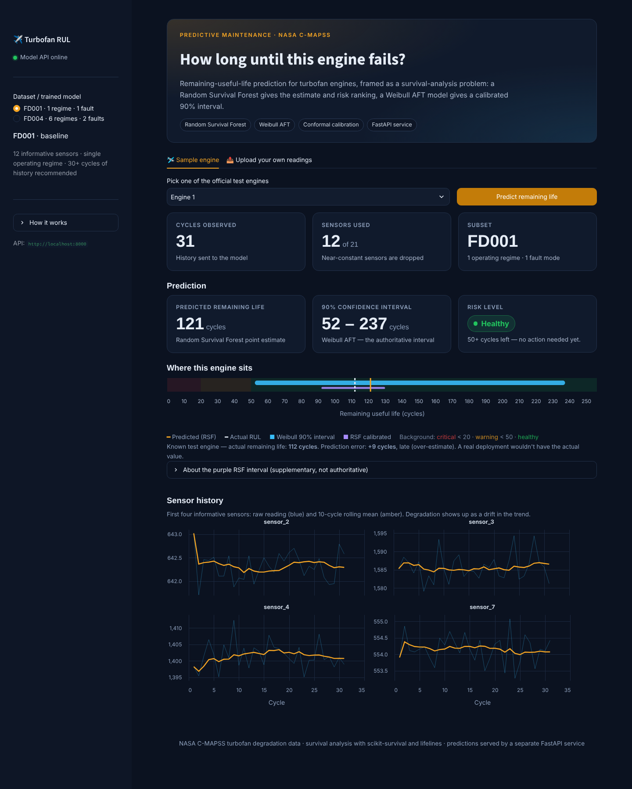

# Turbofan engine remaining useful life — survival analysis

**Live demo: [jetengines-rul.streamlit.app](https://jetengines-rul.streamlit.app/)** — pick a test engine and click *Predict remaining life* (the first load after a quiet period takes a minute or two).

- **Problem:** predict how many cycles a jet engine has left before failure, from 21 sensor readings per cycle (NASA C-MAPSS), with an uncertainty interval — not just a number.
- **Approach:** framed as survival analysis (time-to-failure), comparing Cox PH, Weibull AFT, a Random Survival Forest and two deep hazard networks.
- **Headline result:** the Random Survival Forest wins on NASA's official FD001 test set — **test C-index 0.864, mean error 11.3 cycles, NASA score 4.0 per engine**, a NASA score 2.8× better than Weibull's and 3.6× better than Cox's. The lead holds across 5-fold cross-validation and on the harder FD004 subset.
- **Deployed:** RSF gives the prediction; the 90% interval combines RSF and Weibull AFT (lower bound = the more cautious of RSF's and Weibull's, upper bound = Weibull's), because each model's interval fails at one end of the remaining-life range. Served by a FastAPI service and a Streamlit dashboard.
- **Tested the premise:** with simulated censoring, survival models clearly beat a regression that treats unfinished engines as failed — but a regression that drops them was competitive, a result reported as found.
- **Engineering:** shared `src/` package, reproducible export script, 163 tests run by GitHub Actions on every push (including a check of the live demo's models), Docker images built and smoke-tested in CI, live demo.



## Table of contents

1. [Results at a glance](#1-results-at-a-glance)
2. [Key findings](#2-key-findings)
3. [How it works](#3-how-it-works)
4. [Run it](#4-run-it)
5. [Repository](#5-repository)
6. [Limitations](#6-limitations)
7. [Further reading](#7-further-reading)

---

## 1. Results at a glance

**Model comparison** — NASA's official FD001 test set (100 engines), all models trained on the same 80 engines:

| Model | NASA score ↓ | Test C-index ↑ | RMSE ↓ | MAE ↓ | Late predictions | 90% interval coverage |
|---|---|---|---|---|---|---|
| Cox PH | 1672.5 | 0.821 | 22.01 | 16.91 | 54% | — |
| Weibull AFT | 1288.2 | 0.818 | 23.14 | 18.27 | 48% | 90% |
| LSTM (deep, stretch) | 846.4 | 0.838 | 17.43 | 12.41 | 58% | 73% |
| Conv1D→LSTM (deep, stretch) | 967.3 | 0.843 | 18.34 | 13.34 | 57% | 74% |
| **Random Survival Forest** | **462.5** | **0.864** | **16.27** | **11.99** | 65% | 86% |

**Deployed models** (retrained on all training engines, tuned RSF):

| | FD001 (1 operating regime, 1 fault mode) | FD004 (6 regimes, 2 fault modes) |
|---|---|---|
| RSF test C-index | 0.864 | 0.862 |
| RSF NASA score per engine | 4.04 | 22.4 |
| RSF MAE / RMSE (cycles) | 11.3 / 15.5 | 20.7 / 28.2 |
| 90% interval coverage | 97% | 89% |
| …within 25 cycles of failure | 100% (Weibull alone: 58%) | 94% (Weibull alone: 54%) |

All numbers are for the exported models, measured through the same `inference.predict` the API serves (`notebooks/14`, `notebooks/15`).

**Robustness:**
- **5-fold CV:** RSF C-index 0.850 ± 0.019 vs. Cox 0.798 ± 0.052 and Weibull 0.803 ± 0.048. RSF is best in 4 of 5 folds and the most stable.
- **Harder subsets:** RSF C-index 0.869 on FD003 (2 fault modes) and 0.858 on FD002 (6 regimes).

---

## 2. Key findings

1. **RMSE would have picked the wrong model.** On FD001, Cox beats Weibull on RMSE (22.0 vs 23.1), but Weibull beats Cox on the NASA score (1288 vs 1673), because its errors fall on the safe (early) side. The asymmetric NASA score is the primary metric here: a late prediction means an engine fails in service.
2. **The best model is also the most often late.** RSF has the best NASA score *and* the highest late-prediction rate (65%). Its late errors are small, and the NASA penalty grows exponentially, so many small errors cost less than a few large ones.
3. **Both intervals failed a subgroup check, at opposite ends.** Conformal calibration brought RSF's 90% interval to exactly 90% overall coverage, 40% narrower than Weibull's, but it covered only 27% of engines above the 125-cycle training cap (Weibull: 91%). A later check of the deployed Weibull interval found the reverse: it covered only 58% of engines within 25 cycles of failure, and every miss promised more life than the engine had. The served interval now takes the more cautious lower bound of the two models and Weibull's upper bound, selected on training data only: near-failure coverage went to 100% (FD001) and 94% (FD004) for about one cycle of extra width. [Details](docs/technical_report.md#9-interval-calibration-two-subgroup-checks-at-opposite-ends).
4. **Survival vs. regression, measured.** With 50% of training engines censored, RSF gets RMSE 17.3. The regression that treats unfinished engines as failed gets 23.1 and predicts about 12 cycles too little life. The regression that drops unfinished engines ties RSF (17.4) and has a better NASA score, because the 125-cycle cap absorbs most of the bias from dropping them. RSF's measured edges are stability and using all the data. [Details](docs/technical_report.md#6-does-survival-analysis-actually-beat-regression-tested-with-a-mixed-answer).
5. **Two evaluation bugs changed conclusions.** Comparing a row-level validation C-index (0.901) with an engine-level test C-index (0.864) had produced a fake "regression" after tuning. A feature misalignment on cross-validation folds had inflated a tuning result from 2 to 4 of 5 fold wins. Both were fixed, and every affected notebook was re-run. [All 7 bugs](docs/technical_report.md#11-bugs-caught-along-the-way).

---

## 3. How it works

**Data and labels.** NASA C-MAPSS: training engines run to failure; test engines are cut off before failure, with the true remaining life given separately. Each training row gets a `(duration, event)` label, with remaining life capped at 125 cycles, the standard C-MAPSS convention (`src/turbofan_rul/labeling.py`).

**Features.** 12 informative sensors (9 near-constant ones dropped), then rolling mean/std/min/max/slope over 5/15/30-cycle windows, exponentially weighted averages and cycle count — all computed per engine and backward-looking only. For the multi-regime subsets, sensors are first normalised within each of the 6 operating regimes, which are found by KMeans (`features.py`).

**Models.**

| Model | Role |
|---|---|
| Cox PH | Interpretable baseline. Its proportional-hazards test fails for 14 of 25 features, which motivates the next models. |
| Weibull AFT | Parametric wear-out model (shape ρ = 4.41 from engine lifetimes, i.e. rising failure risk). Provides the interval's upper bound, which can reach past the training cap. |
| Random Survival Forest | No proportional-hazards or distribution assumptions. Its point estimate is the area under the survival curve. Deployed for prediction, and its lower bound keeps the interval cautious near failure. |
| LSTM / Conv1D→LSTM | Discrete-time hazard networks on raw sensor windows (stretch). They didn't beat RSF. |

**Evaluation.** The NASA score is the primary metric:

```
penalty = exp(d/10) − 1   if d > 0  (late — dangerous)
penalty = exp(−d/13) − 1  if d ≤ 0  (early — merely costly)
```

where d = predicted − true RUL. It's reported alongside the test C-index, RMSE/MAE, late-prediction rate, interval coverage and per-risk-bin bias.

**Serving.** `export_deployment_artifacts.py` refits the chosen models on all training engines. `inference.py` is the single scoring function. The Docker setup runs a FastAPI service (`/predict`, `/subsets`, `/subsets/{subset}/metadata`) and a Streamlit dashboard that calls it over HTTP.

**The live demo** runs on Streamlit Community Cloud, which only hosts Streamlit apps. There, the dashboard runs in *embedded mode*: it downloads the exported models from a Hugging Face model repo and calls the same `inference.predict`, so predictions are identical in both modes. Library versions in `app/requirements.txt` are pinned to the export environment, because the models are pickled.

---

## 4. Run it

```bash
pip install -r requirements.txt
export PYTHONPATH=src                       # PowerShell: $env:PYTHONPATH = "src"
python -m turbofan_rul.export_deployment_artifacts --subset FD001
python -m turbofan_rul.export_deployment_artifacts --subset FD004   # optional
pytest tests/ -v                            # 163 tests

# Dashboard against the API (two terminals):
uvicorn api.main:app --reload
API_BASE_URL=http://localhost:8000 streamlit run app/streamlit_app.py

# Or the dashboard alone, loading the models itself:
MODELS_DIR=models streamlit run app/streamlit_app.py

# Or both services in Docker:
docker compose up --build
```

The notebooks in `notebooks/` run in order, `01_eda` through `15_interval_fix`.

**CI.** `.github/workflows/tests.yml` runs the test suite on every push. A second job installs exactly what the live demo installs (`app/requirements.txt`, Python 3.11), downloads the models from Hugging Face and runs the dashboard in embedded mode with real predictions (`tests/test_dashboard_embedded.py`), so a library-version mismatch with the uploaded models fails CI instead of the live site. It needs one repository variable: **Settings → Secrets and variables → Actions → Variables → `MODEL_REPO`** = your Hugging Face model repo. To run the embedded-mode test locally, set `MODELS_DIR=models` (or `MODEL_REPO`) before `pytest`.

**Docker CI.** `.github/workflows/docker.yml` builds both images with `docker compose`, starts them, and runs `scripts/docker_smoke_test.py` inside each container: the API must serve FD001 and FD004 predictions in the expected range (and reject a bad request with 422), and the dashboard must reach the API over the Compose network and make a prediction through it. It runs weekly, on demand, and on pushes that change anything inside the images (about 9 minutes, most of it the in-image model export).

---

## 5. Repository

```
├── notebooks/            # 01 EDA → 12 interval calibration → 13 censoring experiment → 14–15 interval fix
├── src/turbofan_rul/     # data loading, labeling, features, models, evaluation, CV, conformal, inference, export
├── tests/                # 163 tests (GitHub Actions: .github/workflows/tests.yml)
├── scripts/              # Docker smoke test (GitHub Actions: .github/workflows/docker.yml)
├── api/                  # FastAPI service + Dockerfile
├── app/                  # Streamlit dashboard, Community Cloud requirements, Dockerfile
├── .streamlit/           # dashboard theme
├── docs/                 # technical report, project brief, architecture walkthrough
└── docker-compose.yml
```

---

## 6. Limitations

- **FD004 is a transfer test.** It deliberately reuses FD001's tuned hyperparameters, to check whether the FD001 recipe holds on a harder subset without re-tuning. FD002 and FD003 are evaluation-only.
- **Long-lived engines on FD004.** The interval covers 73% of FD004 test engines with more than 125 cycles left. These misses are on the safe side (the engine outlives the interval), but fixing them needs a model trained without the 125-cycle cap, not more calibration.
- **Censoring convention.** Training labels treat rows beyond the 125-cycle cap as failures at 125, the standard convention. Censoring those rows instead broke the Weibull model, so it was rejected.
- **The survival-vs-regression evidence comes from simulated censoring** on FD001, with untuned regressors.
- **The live demo runs in one process** (embedded mode), not as two services. This is a free-hosting constraint.

---

## 7. Further reading

- [`docs/technical_report.md`](docs/technical_report.md) — the full methods, every result table, the decisions and the bug log.
- [`docs/project_brief.md`](docs/project_brief.md) — the original specification and how each part changed.
- [`docs/architecture_walkthrough.md`](docs/architecture_walkthrough.md) — the build history, phase by phase.
